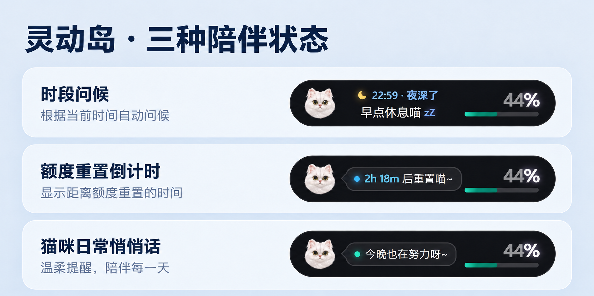

# Codex Flow
> **测试版**：欢迎在 Windows 上试用并反馈。Codex 和 Grok Bot 的真实消息提醒尚未在全新 Windows 用户环境中完成验证，使用前请参考下面的设置说明。

Codex Flow 是一个 Windows 桌面灵动岛：在屏幕顶部查看 Codex 额度、接收本机 Codex 和 Grok Bot 的新回复，并在使用 QQ 音乐时显示歌词。

[观看功能展示视频](docs/assets/demo.mp4)



图中为三种陪伴状态的示意，文字和额度随实际情况变化。

## 安装与使用

1. 使用 Windows 10/11 64 位系统，从项目的 GitHub Releases 下载并安装最新安装包。系统需要 Microsoft Edge WebView2 Runtime；若尚未安装，安装程序会引导安装。
   当前安装包未签名，Windows 可能显示未知发布者提示。
2. 启动 Codex Flow，在托盘菜单打开「设置 → 提醒」，启用「应用消息提醒」。
3. **Codex：** 点击「连接 Codex」旁的「配置」，然后在 Codex 的 Hooks 设置中审核并启用新添加的 Codex Flow Stop 钩子；也可在 Codex CLI 输入 `/hooks` 完成审核。重启 Codex 后测试一条新回复。已有的其他钩子会保留；如已存在 Codex Flow 钩子，程序不会重复添加或自动替换。
4. **Grok Bot：** 在同一个 Windows 用户下安装、打开并登录 Grok Bot。启用消息提醒后，新完成的机器人文字回复会自动显示；以前的消息不会重播。

Codex 与 Grok Bot 提醒走本机通道，不需要打开 Windows 系统通知。若 Codex 的钩子被组织策略禁用、未审核或对应会话由云端编排，Codex 不会运行本地钩子。更多信息见 [Codex Hooks 官方说明](https://developers.openai.com/codex/hooks)。Grok Bot 接入依赖其当前本地数据格式，该格式不是公开稳定接口；Grok Bot 更新后可能需要适配。

Codex Flow 默认向当前用户的 `.codex/hooks.json` 添加配置；若启动 Codex Flow 时设置了 `CODEX_HOME`，则使用该目录。移动或卸载程序前，可在 Codex 的 Hooks 设置或 `/hooks` 中禁用对应钩子；移动安装位置后，需要移除旧的 Codex Flow 钩子，再重新配置并审核。

提醒只在 Codex Flow 运行且消息功能启用时出现。Codex 发送给灵动岛的是回复文本；Grok Bot 会读取当前 Windows 用户的本地机器人数据来发现新回复。Codex Flow 不另存这些消息，也不将它们上传到自己的服务器。额度信息通过本机 Codex 获取，Codex 本身可能需要联网。

## 从源码构建

需要 Node.js 20.19+ 或 22.12+、较新的 Rust（SHA-2 依赖要求 1.88 或更高）、Windows C++ 构建工具和 Tauri 2 的 Windows 依赖。安装依赖及构建：

```powershell
npm ci
npm test
npm run tauri:build -- --bundles nsis
```

首次构建可能需要下载 Rust 依赖和 Tauri 安装包工具。开发模式使用 `npm run tauri:dev`。请参考 [Tauri Windows 安装包文档](https://v2.tauri.app/distribute/windows-installer/)。

项目暂时保留两份上游组件的依赖修复，以使用修复后的 `block-buffer`；来源、许可证和后续更新方法见 [vendor/README.md](vendor/README.md)。

## 隐私和许可证

本项目源码采用 [MIT License](LICENSE)。第三方代码及素材的许可见 [THIRD_PARTY_NOTICES.md](THIRD_PARTY_NOTICES.md)。

不要将自己的 Codex 配置、聊天记录文件、账户数据库、应用设置或历史工作资料加入仓库。此源码发行目录不包含这些文件；展示视频保留作者提供的原始演示内容。提交前仍应检查新增文件与 Git 历史。
